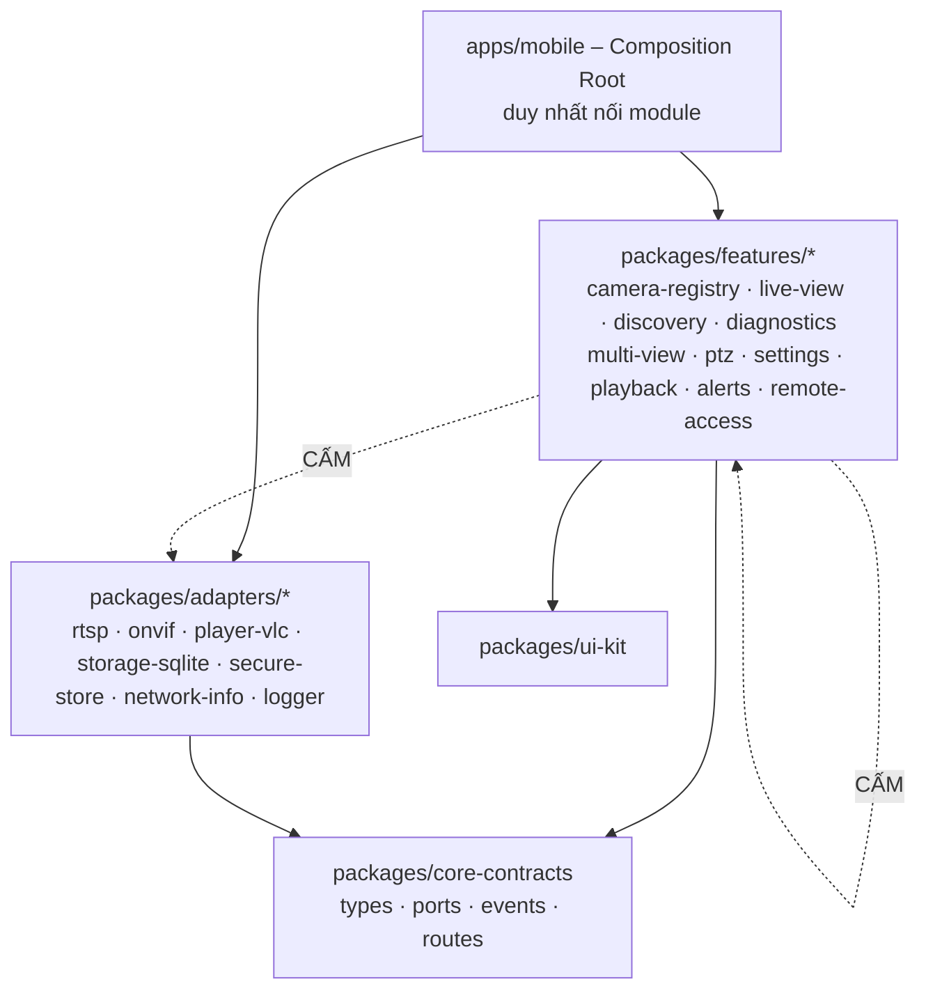

# Universal IP Camera Viewer (UICV) – Bộ tài liệu BA/SRS

Phiên bản **0.2** · 2026-10-30 · Trạng thái: **Draft – chưa có PoC**

## 1. Kết luận chính
1. **Khả thi có điều kiện:** Live View LAN qua RTSP là hướng khả thi nhất. Yoosee và một số Imou được nguồn cộng đồng báo cáo có RTSP/ONVIF khi bật trong app hãng; **chưa có mục nào Verified**.
2. **Không thể thay thế 100% app hãng:** push, playback thẻ nhớ, đàm thoại 2 chiều, xem từ xa thường phụ thuộc cloud/giao thức riêng.
3. **Kiến trúc MVP:** Direct LAN-first, không backend, **tổ chức module độc lập (file 17)**.
4. **Rủi ro lớn nhất:** camera không hỗ trợ RTSP; player RTSP trên React Native chưa kiểm chứng (đặc biệt iOS).
5. **Việc bắt buộc tiếp theo:** chạy PoC (TC-POC-01…06) trên camera thật.

## 2. Tổ chức source theo module (tóm tắt – chi tiết ở file 17)
Mục tiêu: module độc lập, không gọi chéo, tái sử dụng được như micro-frontend ở dự án khác.

**Luật vàng:**
- Feature chỉ import `core-contracts` + `ui-kit`. **Cấm feature import feature khác và cấm import adapter.**
- Giao tiếp qua 3 kênh: **Port được tiêm**, **Event bus có kiểu**, **Route/Intent do host điều phối**.
- Mỗi module có public API `index.ts`, test riêng với fake, sandbox app riêng, README cách nhúng.
- Luật được kiểm soát tự động trong CI (lint boundaries + dependency-cruiser).
- Dùng lại: publish từng module thành package, dự án mới chỉ cần viết adapter cho Port.
- Lưu ý: runtime micro-frontend cho React Native (Module Federation) là hướng nâng cao cần PoC (SP-08), MVP dùng build-time modules.

Ánh xạ requirement → module: file 17 mục 10.

## 3. Flow chính (chi tiết ở file 18)
| Flow | Nội dung | Module |
|---|---|---|
| A1 | Thêm camera (kèm rollback secret) | camera-registry, diagnostics |
| A2 | Máy trạng thái Live View | live-view |
| A3 | Reconnect & đổi mạng | live-view |
| A4 | Multi-view, slot decoder | multi-view |
| A5 | Playback (Profile G, timeline phân trang) | playback (Future) |
| A6 | Cảnh báo/sự kiện (LAN và push) | alerts (Future) |
| A7 | Remote access (relay + agent) | remote-access (Future) |
| A8 | Snapshot/Ghi hình | live-view |
| A9 | Xóa camera, các module tự dọn qua event | tất cả |
| B1–B7 | Kim tự tháp test, CI, PoC, test theo module, vòng đời lỗi, ma trận thiết bị | – |

## 4. Xử lý dữ liệu lớn (file 19)
Nguyên tắc cốt lõi: khung hình video **không đi qua JS**; multi-view dùng sub stream và chỉ phát ô đang hiển thị; mọi danh sách dùng ảo hóa + phân trang cursor + index; playback truy vấn theo cửa sổ thời gian, chỉ giữ metadata; cảnh báo có throttle, khử trùng lặp, batch ghi, retention; cảnh báo khi app đóng **bắt buộc có backend + agent + push**.

## 5. Tài liệu cần đọc & kỹ thuật cần nghiên cứu (file 20)
8 nhóm nguồn (giao thức camera, camera cụ thể, player RN, module hóa, relay/remote, hiệu năng, bảo mật/pháp lý, test/CI) kèm trạng thái xác minh, độ tin cậy, lịch đọc, và **13 spike kỹ thuật (SP-01…SP-13)**.

## 6. Kế hoạch triển khai (file 21)
Setup môi trường → repo → code theo thứ tự module → test → CI/CD → TestFlight/Play Internal → cửa hàng → domain/hosting (trang chính sách bắt buộc cho store; backend/relay chỉ ở Phase 4).

## 7. Mục lục đầy đủ
| File | Nội dung |
|---|---|
| [00](00-project-overview.md) | Tổng quan |
| [01](01-business-requirements.md) | Business requirements |
| [02](02-scope-and-mvp.md) | Scope & MVP (MoSCoW) |
| [03](03-feasibility-and-camera-compatibility.md) | Feasibility, nguồn, ma trận tương thích |
| [04](04-functional-requirements.md) | FR + User Stories + AC |
| [05](05-user-flows-and-business-rules.md) | Flow, sequence, business rules |
| [06](06-ui-ux-specification.md) | Màn hình |
| [07](07-solution-architecture.md) | Kiến trúc tổng thể |
| [08](08-api-specification.md) | API |
| [09](09-data-model.md) | Data model |
| [10](10-security-and-privacy.md) | Bảo mật |
| [11](11-non-functional-requirements.md) | NFR |
| [12](12-test-plan-and-test-cases.md) | Test plan, PoC, test case |
| [13](13-project-roadmap-and-estimation.md) | Roadmap & effort |
| [14](14-risks-assumptions-and-open-questions.md) | Rủi ro, giả định, câu hỏi mở |
| [15](15-traceability-matrix.md) | Traceability |
| [16](16-actors-and-use-cases.md) | Actors & Use Cases |
| [17](17-modular-architecture-and-source-structure.md) | **Module hóa & cấu trúc source** |
| [18](18-detailed-feature-flows-and-test-flows.md) | **Flow chức năng & flow test** |
| [19](19-large-data-and-performance-handling.md) | **Dữ liệu lớn & hiệu năng** |
| [20](20-research-reading-list.md) | **Tài liệu cần đọc & spike** |
| [21](21-implementation-plan-setup-to-deploy.md) | **Kế hoạch setup → deploy → domain/hosting** |

## 8. Đối chiếu Definition of Done
| # | Mục | Trạng thái |
|---|---|---|
| 1 | Phân tích khả thi | Có (03) |
| 2 | Ma trận tương thích có bằng chứng | Có, **chưa Verified** |
| 3 | MVP rõ | Có (02) |
| 4 | User flow & business rules | Có (05, 16, 18) |
| 5 | Kiến trúc | Có (07, 17) |
| 6 | Data model & API | Có (08, 09) |
| 7 | Security | Có (10) |
| 8 | Test plan & AC | Có (12, 18B) |
| 9 | Roadmap & effort | Có (13, 21) |
| 10 | Risk/assumption/OQ | Có (14) |
| 11 | Traceability | Có (15) |
| 12 | Kế hoạch PoC | Có (12, 18-B3); **chưa thực thi** |

## 9. Thứ tự đọc đề xuất
README → 03 → 16 → 17 → 18 → 12 (PoC) → 20 → 21 → phần còn lại.

## 10. Nguồn chính đã truy cập (2026-10-30)
- ispyconnect.com (Yoosee, Imou) · camlytics.com · community.home-assistant.io · forum.felenasoft.com · ipcamtalk.com
- sec-consult.com (Gwelltimes) · gladysassistant.com · scos.co.uk · npmjs.com (react-native-vlc-media-player)
- onvif.org (Profile G v1.1, Profile Feature Overview) · videoexpertsgroup.com (Profile S/T) · docs.rs/oxvif
- go2rtc / kinboard wiki / smartrtsp.com (relay RTSP→WebRTC)

> Phần lớn nguồn là cộng đồng/bên thứ ba. Không tài liệu chính thức nào của Yoosee/Imou được xác minh. Các nguồn đánh dấu ○ trong file 20 chưa được mở trong phiên này.
